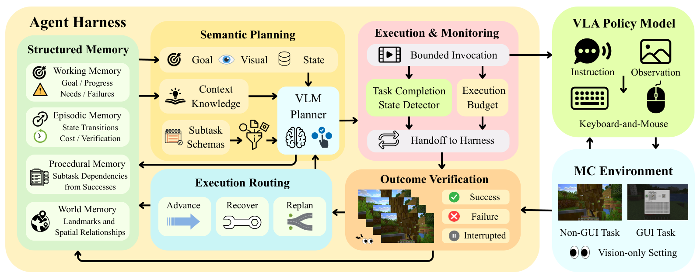

<h1 align="center">HiSTEVE<br><sub>Harnessing Human-Interface VLA Agents for Open-World Games</sub></h1>

<p align="center"><strong>A three-layer agent harness for long-horizon Minecraft tasks.</strong></p>

<p align="center">
  <a href="#overview">Overview</a> · <a href="#installation">Installation</a> · <a href="#usage">Usage</a> · <a href="#repository-layout">Code</a> · <a href="#citation">Citation</a>
</p>

<p align="center">
  
</p>

## Overview

Long-horizon gameplay requires an agent to track what has been achieved, decide what to do next, and recognize when a local action sequence has finished. HiSTEVE coordinates a vision-language planner and a native-control VLA through a three-layer harness. The planner selects subtasks from the goal, visual observations, and execution history; the VLA carries them out through keyboard-and-mouse actions; the harness uses execution outcomes to update subsequent decisions.

This repository contains the harness, Minecraft subtask definitions, and model interfaces. Connect it to your VLM backend, VLA, policy-coupled state detector, and MineStudio environment adapter.

- **Capability-aware planning.** Parameterized subtasks describe the objectives supported by the VLA, their applicability, and their completion conditions.
- **State-dependent handoff.** A task-completion detector uses visual history and VLA policy context to decide when to return control. The harness then reassesses the outcome from images.
- **Structured memory.** Working state, execution records, successful subtask sequences, and visual landmarks carry context across planning decisions.

### The execution loop

1. **Plan.** The VLM selects an applicable subtask using the goal, recent images, current state, and retrieved experience.
2. **Execute.** The harness renders a fixed instruction for the VLA. Execution continues until the detector signals candidate completion or the subtask budget is reached.
3. **Verify and update.** Visual verification assesses progress and completion. The harness updates memory, retries a recoverable subtask, or returns to planning.

The state detector controls the timing of a handoff; visual verification determines its outcome. Planning and verification can share the same VLM backend. See [design notes](docs/design.md) for the runtime and memory details.

## Installation

Python 3.10 or newer. From the repository root:

```bash
pip install -e .
```

The harness uses the Python standard library. Model inference and MineStudio run through your own adapters and their dependencies.

## Minecraft Environment

HiSTEVE uses [MineStudio](https://github.com/CraftJarvis/MineStudio) as its Minecraft runtime. An environment adapter connects MineStudio to the harness, providing environment initialization, first-person observations, and keyboard-and-mouse action execution. The VLA produces actions from the current observation and subtask instruction, while the state detector monitors execution and signals when control should return to the harness.

Follow the [MineStudio documentation](https://craftjarvis.github.io/MineStudio/) to set up the simulator. To run HiSTEVE, provide a MineStudio environment adapter together with the VLM, VLA, and state detector backends.

## Usage

With an initialized environment and model adapters, run a natural-language goal:

```python
from histeve.minecraft.runtime import run

try:
    result = run(
        "Obtain one iron ingot.",
        env,
        visual_query=visual_query,
        action_model=vla,
        detector_model=state_detector,
        steps=12000,
        minutes=40,
    )
    print(result.termination, result.steps)
finally:
    env.close()
```

The adapters provide four interfaces:

| Component | Interface |
| --- | --- |
| VLM | `visual_query(images, request) -> dict` for planning and verification |
| VLA | `reset()`, `set_route(...)`, `act(frame, instruction) -> NativeAction`, and `policy_context(frame, instruction)` |
| State detector | `predict(history, current, instruction, policy_context) -> float` |
| Environment | `initial_frame() -> Frame`, `step(action) -> Frame`, and `close()` |

The [interface definitions](src/histeve/interfaces.py) describe the exchanged types. Each action advances one environment step. [ImageJSONClient](src/histeve/adapters.py) provides a client for OpenAI-compatible vision endpoints.

<details>
<summary>Command-line entry point</summary>

The [Minecraft runner](scripts/run_minecraft.py) loads a Python adapter module exporting `visual_query`, `action_model`, `detector_model`, and `make_environment(seed)`. Make that module importable, then run from the repository root:

```bash
python -m scripts.run_minecraft --adapter my_adapter --goal "Obtain one iron ingot."
```

</details>

## Repository layout

```text
HiSTEVE-harness/
├── assets/                   # Architecture figure
├── src/histeve/
│   ├── harness.py            # Planning, execution and verification loop
│   ├── planner.py            # VLM planning and visual verification
│   ├── executor.py           # VLA execution and detector handoff
│   ├── memory.py             # Execution history, procedures and landmarks
│   ├── interfaces.py         # Model and environment interfaces
│   ├── prompts.py            # Planning and verification prompts
│   ├── subtasks.py           # Subtask schemas and applicability
│   └── minecraft/            # Runtime assembly, recipes and instructions
├── scripts/                  # Task runner
├── experiments/longbench/    # LongBench evaluation and environment configs
├── tests/                    # Harness and evaluation tests
└── docs/                     # Design details
```

## Configuration

Use `build_harness()` from [minecraft/runtime.py](src/histeve/minecraft/runtime.py) to configure an episode, or construct `Harness` directly to supply your own planner, verifier, subtasks, and memory.

| Setting | Location |
| --- | --- |
| Handoff mode, detector threshold, recent-frame window, retry limit | `RuntimeConfig` in [interfaces.py](src/histeve/interfaces.py) |
| Subtask arguments, completion conditions, execution budgets | [minecraft/subtasks.json](src/histeve/minecraft/subtasks.json) |
| VLA instructions and recipe knowledge | [minecraft/instructions.py](src/histeve/minecraft/instructions.py), [minecraft/recipes.py](src/histeve/minecraft/recipes.py) |
| Planning and verification prompts | [prompts.py](src/histeve/prompts.py) |

## Development

```bash
pip install -e '.[test]'
python -m pytest -q
```

[LongBench](experiments/longbench/README.md) provides a separate, experimental evaluation suite with task definitions, reset configurations, and scoring tools.


## Citation

If you find HiSTEVE useful in your research, please consider citing our paper:

```bibtex
@article{tang2026histeve,
  title   = {HiSTEVE 1.0: Harnessing Human-Interface VLA Agents for Open-World Games},
  author  = {Tang, Zecong and Guan, Zian and Guo, Yuncheng and Zhang, Zhanqiu and Guo, Yiwen and Dai, Bo},
  journal = {arXiv preprint arXiv:2610.31162},
  year    = {2026},
  url     = {https://arxiv.org/abs/2610.31162}
}
```

